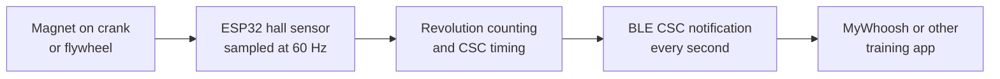

# ESP32 BLE CSC

**Turn a basic exercise bike into a smart bike for MyWhoosh and other training apps.**


The ESP32 acts as a Bluetooth speed and cadence sensor, using its built-in hall sensor and a magnet on the bike. Apps see it as **ESP Rowerek** (*rowerek* is Polish for "little bike"). The name can be changed in the [configuration](#configuration).

## Features

- **No sensor wiring**: the ESP32's built-in hall sensor detects a magnet on the crank or flywheel.
- **Standard BLE Cycling Speed and Cadence (CSC) service** with speed and cadence data.
- **Realistic speed** from a configurable virtual gear ratio.
- **Stop detection**: speed and cadence go to zero a few seconds after you stop.
- **Reliable Bluetooth**: advertising restarts automatically, and up to 3 devices can connect at once.
- **LED feedback** on every magnet pass.

## How it works



1. A hardware timer wakes a FreeRTOS task 60 times per second to read the hall sensor.
2. Two thresholds with hysteresis turn the readings into clean magnet passes. Each pass counts as one pedal (crank) revolution.
3. Wheel revolutions are derived from pedal revolutions using the virtual gear ratio (4.1 by default, similar to a big road bike gear such as 53×13), with the wheel event time interpolated between pedal revolutions.
4. Every second, a CSC notification with the total revolutions and event times is sent to connected apps. They calculate speed and cadence from the difference between two notifications.
5. After `stopTimeoutMs` without a revolution, the event times keep moving while the totals stay the same, so apps show zero.

## Requirements

- **Classic ESP32 board** (e.g. ESP32 DevKit with ESP32-WROOM-32). ESP32-S2, S3, C3 and C6 have no built-in hall sensor (see [External sensor](#external-sensor-not-tested)).
- **Arduino-ESP32 core 2.x**, because `hallRead()` was removed in 3.x. PlatformIO installs the pinned versions automatically (`espressif32@7.1.3` with Arduino-ESP32 2.0.17, NimBLE-Arduino 2.5.2).
- [PlatformIO](https://platformio.org/) (VS Code extension or CLI).
- **A strong magnet** (e.g. neodymium), since the built-in sensor is not very sensitive. It must pass close to the ESP32 **once per pedal revolution**. If your flywheel spins faster than the pedals, attach the magnet to the crank instead.

## Getting started

1. Clone the repository and open it in VS Code with the PlatformIO extension.
2. Mount the ESP32 so the magnet passes as close as possible to the ESP32 module. The hall sensor is inside the chip, under the metal shield.
3. Build and upload the firmware from the terminal:
   ```sh
   pio run -t upload
   ```
   Or in VS Code, click **Upload** in the status bar.
4. Pedal slowly and check that the on-board LED lights up (or `Hall Triggered` appears in the serial monitor) once per revolution. If it doesn't, tune the hall thresholds (see [Tuning the hall thresholds](#tuning-the-hall-thresholds)).
5. In your training app, pair **ESP Rowerek** as the speed sensor and cadence sensor.

| Environment | Purpose |
|---|---|
| `esp32release` | Default: optimized build (LTO, framework logging disabled) |
| `esp32dev` | Standard build with framework defaults |

## Configuration

> [!IMPORTANT]
> Hall sensor readings differ from one ESP32 chip to another and depend on where the board is mounted and how strong the magnet is. The default thresholds were tuned on the author's bike, so **`hallHighThreshold` and `hallLowThreshold` will most likely need adjusting for yours**.

All settings are in the config block at the top of [`src/main.cpp`](src/main.cpp):

| Setting | Default | Tuning | Description |
|---|---|---|---|
| `hallHighThreshold` | `165` | **Per setup** | Reading that starts a magnet pass |
| `hallLowThreshold` | `130` | **Per setup** | Reading that ends it, keep it a bit below the high threshold |
| `printHallReadings` | `false` | For tuning | Prints every hall reading to the serial monitor |
| `sampleRateHz` | `60` | Rarely | Hall sensor reads per second. Raise it if fast pedaling misses revolutions |
| `wheelToCrankRatio` | `4.1` | Optional | Virtual gear ratio (wheel turns per pedal turn), 1 or more. Higher means more speed in the app and more power in MyWhoosh |
| `stopTimeoutMs` | `5000` | Optional | Time without a revolution before speed and cadence go to zero. Keep it longer than one pedal revolution at your slowest pace |
| `minRevolutionMs` | `200` | Rarely | Minimum time between revolutions, rejects double pulses |
| `deviceName` | `"ESP Rowerek"` | Optional | Bluetooth name, up to 18 ASCII characters (longer names don't fit in the Bluetooth advertisement). Pair the sensor again after renaming |
| `ledPin` | `2` | Per board | On-board LED pin (GPIO 2 on many ESP32 DevKit boards) |

### Tuning the hall thresholds

1. Set `printHallReadings` to `true` and upload.
2. Open the serial monitor (`pio device monitor` or the Serial Monitor button in VS Code) and turn the pedals. Note the readings when the magnet is away and the peaks when it passes. Check a fast cadence too, as the peaks can come out lower.
3. Set `hallHighThreshold` comfortably above the idle readings and below the peaks, and `hallLowThreshold` between the idle readings and `hallHighThreshold`.
4. Set `printHallReadings` back to `false` and upload again. The on-board LED should now light up once per pedal revolution, and each revolution prints `Hall Triggered: <value>`.

The code counts readings that rise when the magnet passes. If yours drop instead, flip the magnet. If they barely change, move the ESP32 closer or use a stronger magnet.

### External sensor (not tested)

Needed on chips without the built-in hall sensor, such as the ESP32-S3 or C3 (the S2 has no Bluetooth, and the C6 isn't supported by Arduino core 2.x), or if the built-in sensor is too weak. Replace `hallRead()` in `hallTask` and, for other chips, change `board` in `platformio.ini`. Keep the sensor's output at 3.3 V or less.

| Sensor | Replace `hallRead()` with | Thresholds |
|---|---|---|
| Analog hall sensor (e.g. SS49E) | `analogRead(pin)` | Tune them as described in [Tuning the hall thresholds](#tuning-the-hall-thresholds) |
| Digital hall sensor or reed switch | `!digitalRead(pin)`, with `pinMode(pin, INPUT_PULLUP)` in `setup()` | `1` (high) and `0` (low) |

## Troubleshooting

| Problem | What to check |
|---|---|
| Upload fails or no serial port | Use a USB data cable (some cables only charge), install the USB driver for your board (CP210x or CH340), or hold the BOOT button while uploading |
| Sensor doesn't show up in the app | Check that the ESP32 is powered, and try restarting Bluetooth on the device running your training app (phone, tablet, PC, etc.) |
| Cadence too high or jumpy | Thresholds too low, or the magnet passes the sensor more than once per pedal revolution |
| Cadence too low when pedaling fast | The magnet passes too far from the sensor or too quickly. Move the ESP32 closer, lower the thresholds or raise `sampleRateHz` |
| Speed feels too slow or too fast | `wheelToCrankRatio`, or the wheel size setting in your app |
| Speed doesn't drop right after you stop | It drops to zero after `stopTimeoutMs` (5 s by default) |

## Notes on MyWhoosh

- Tested with MyWhoosh, where speed and effort feel close to a real ride.
- MyWhoosh calculates virtual power from the speed sensor data.
- MyWhoosh doesn't allow speed sensors in events.
- Any app that supports the standard BLE CSC profile should work, but only MyWhoosh has been tested. The SC Control Point (0x2A55), used to reset the wheel count, isn't implemented.

## Project structure

```
src/main.cpp              Settings, hall sensor sampling, revolution counting, CSC timing
src/blecsc.cpp            BLE CSC service, advertising and connection handling
include/blecsc.h          BLE interface
platformio.ini            Build environments (release and standard)
scripts/lto_linkflags.py  Silences a NimBLE warning in the LTO build
```

## License

This project is licensed under the MIT License. See [LICENSE](LICENSE) for details. The libraries it uses (Arduino-ESP32, NimBLE-Arduino) are downloaded by PlatformIO and keep their own licenses.

*Not affiliated with MyWhoosh. All trademarks belong to their respective owners.*
